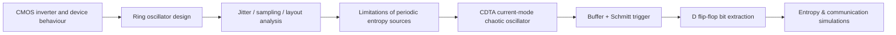
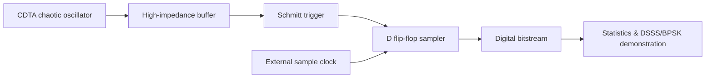

<div align="center">

# CMOS True Random Number Generation
### From Ring-Oscillator Jitter to Current-Mode Chaotic Entropy

**Analog & Mixed-Signal VLSI | Hardware Security | CMOS Circuit Design | Nonlinear Dynamics**


*A two-semester study of CMOS entropy sources, analog-to-digital bit extraction and simulated security applications.*

</div>

---

## Overview

This repository consolidates two collaborative B.Tech Electronics and Communication Engineering projects conducted at the **Faculty of Technology, University of Delhi (2025–2026)**.

- **Semester V — Ring-oscillator TRNG:** transistor-level CMOS inverter and ring-oscillator design, including conventional, current-starved, dynamic-CMOS and interconnected polygonal structures, along with Cadence Virtuoso simulation and layout checks.
- **Semester VI — CDTA-based chaotic TRNG:** a current-mode nonlinear oscillator, buffered and Schmitt-trigger-conditioned digital bit extraction, entropy analysis, and communication-system simulations.

> **Research status:** These are academic, simulation-based studies. Neither a fabricated chip nor an independently certified cryptographic entropy source is claimed. Detailed results and limitations are described in the original reports, which are prepared for upload to `docs/`.

## Research progression



## Phase I · CMOS ring-oscillator approach

The Semester V project studies standard CMOS inverter-based rings and explores **tetrahedral, pentagonal, and hexagonal oscillators**, as well as **current-starved** and **dynamic CMOS ring-oscillator** implementations.

**Engineering scope**
- Cadence Virtuoso `gpdk90` schematic capture and Spectre transient simulation.
- Frequency, supply-voltage, power and harmonic-response comparisons.
- Full-custom layout work, with reported DRC, LVS and parasitic-extraction checks for the dynamic-CMOS ring oscillator.
- Clocked D flip-flop sampling for bitstream generation.

**Relevant report:** *Ring Oscillator Based Truly Random Number Generator Design in Cadence Virtuoso* (Semester V).

## Phase II · CDTA-based chaotic approach

The Semester VI project explores nonlinear, aperiodic current-mode oscillation using a **Current Differencing Transconductance Amplifier (CDTA)**. The reported architecture routes a chaotic analog signal through an isolation buffer, hysteresis stage and D flip-flop sampler to obtain a digital bitstream.



**Reported simulation findings**
- 10,002 generated bits evaluated in the Semester VI study.
- Shannon entropy reported as **0.999968 bits per symbol** on that bitstream.
- Phase-space and FFT analysis of simulated chaotic oscillation.
- Simulated BPSK/DSSS applications and exploratory next-bit predictability analyses.

These results are **report-specific simulation outcomes**. A near-unity Shannon entropy estimate does not by itself establish min-entropy, physical unpredictability, resistance to implementation attacks or compliance with NIST SP 800-90B.

## Comparison

| Attribute | Semester V: RO TRNG | Semester VI: Chaotic TRNG |
|---|---|---|
| Entropy concept | Oscillator jitter and sampling uncertainty | Nonlinear continuous-time chaotic dynamics |
| Analog core | CMOS ring oscillators | Current-mode CDTA oscillator |
| Digital extraction | Clocked D flip-flop | Buffer + Schmitt trigger + clocked D flip-flop |
| Key analyses | Frequency, power, THD, custom layout checks | Phase portraits, FFT, entropy and predictability analysis |
| Applications | Hardware randomness research | Hardware randomness and simulated secure communications |
| Validation | Transistor-level simulations and reported layout checks | Analog / digital simulations and numerical analysis |

## Documentation

The complete original collaborative reports are intended to reside here:

- `docs/01_Ring_Oscillator_TRNG_Semester_V.pdf`
- `docs/02_CDTA_Chaotic_TRNG_Semester_VI.pdf`

**Upload status:** The text documentation is published first; the report PDFs and extracted images need to be uploaded separately. Until then, the entries above describe the planned repository contents, not available downloads.

See [methodology](notes/methodology.md) and [reproducibility](notes/reproducibility.md) for a structured explanation of experimental scope and files required for replication.

## Repository layout

```text
CMOS-TRNG-Research/
├── README.md
├── CITATION.cff
├── .gitignore
├── notes/
│   ├── methodology.md
│   └── reproducibility.md
├── docs/                     # Original PDFs pending upload
│   ├── 01_Ring_Oscillator_TRNG_Semester_V.pdf
│   └── 02_CDTA_Chaotic_TRNG_Semester_VI.pdf
└── assets/                   # Report-derived figures pending upload
    ├── ring_oscillator.png
    └── chaotic_trng_pipeline.png
```

## Research team and supervision

**Contributors:** Berson Meshak J, Nikhil Yadav, Sarvesh Kumar and Kushi Dixit.  
**Institution:** Faculty of Technology, University of Delhi, India.  
**Semester V supervision:** Prof. P. K. Singh and Dr. Khushwant Sehra (as credited in that report).  
**Semester VI supervision:** Prof. Raj Senani and Dr. Khushwant Sehra (as credited in that report).

## Attribution and use

This repository documents collaborative academic work. Attribute all four contributors when citing the projects. Some background figures and architectural ideas draw upon external publications identified in the reports; check those references before reuse. No open-source licence is asserted for the original reports, proprietary EDA assets or third-party figures.

---

<div align="center"><sub>University of Delhi · Electronics and Communication Engineering · 2025–2026</sub></div>
